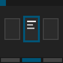
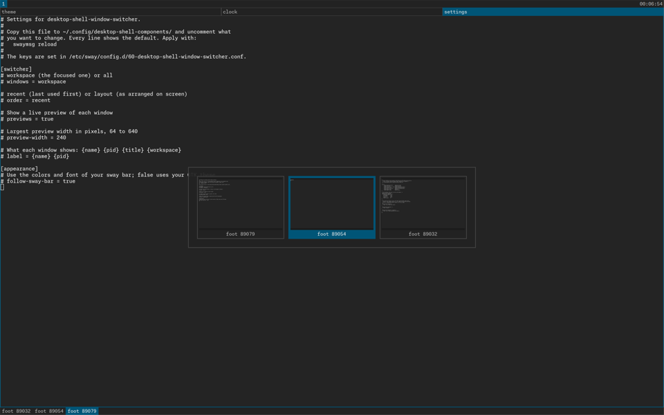

# desktop-shell-components

**Completely vibecoded. Use at your own risk.**

Login screen, window bar, Alt+Tab switcher and title bar text for sway. They take their
colors and font from your sway bar, or from your GTK theme.

| Program                                                  | Adds                                              |
|----------------------------------------------------------|---------------------------------------------------|
| [window bar](programs/workspace-window-bar)              | the windows of the current workspace, at the bottom |
| [window switcher](programs/window-switcher)              | Alt+Tab with live previews                        |
| [window title format](programs/window-title-format)     | the process ID in each window's title bar         |
| [window menu](programs/window-context-menu)              | right-click a title bar: force close, copy PID... |
| [login greeter](programs/login-greeter)                  | a login screen for greetd                         |

## Install

Arch Linux:

    cd distribution-packaging/arch-linux
    makepkg -si
    swaymsg reload

Other systems:

    meson setup build --prefix=/usr --sysconfdir=/etc
    meson compile -C build
    sudo meson install -C build

Needs sway 1.12, gtk4 4.16, gtk4-layer-shell and json-glib.

## Configure

Optional: everything works without configuration.

| To change            | Edit, in `~/.config/desktop-shell-components/` |
|----------------------|------------------------------------------------|
| a program's settings | `PROGRAM.ini`, copied from `/etc/xdg/desktop-shell-components/` |
| colors and font      | `shared-theme.css`                             |
| a program's look     | `PROGRAM.css`                                  |

Then run `swaymsg reload`. Each program's page lists its settings.

Colors are CSS variables. Set only the ones you want:

    :root {
        --theme-background-color: #222222;
        --theme-text-color: #eeeeee;
        --theme-secondary-text-color: #bbbbbb;
        --theme-accent-color: #005577;
        --theme-accent-text-color: #eeeeee;
        --theme-border-color: #444444;
        --theme-urgent-color: #900000;
    }

## License

0BSD.
