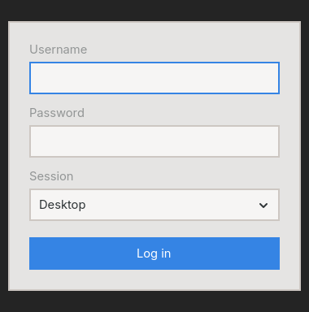
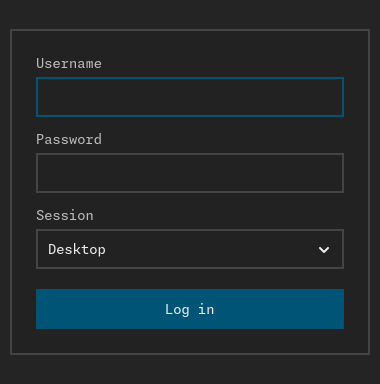

# Login greeter

| Your GTK theme | Your sway theme |
|----------------|-----------------|
|  |  |

A login screen for greetd.

## Setup

1. In `/etc/greetd/config.toml`:

       [default_session]
       command = "sway --config /etc/greetd/login-greeter-compositor-configuration"
       user = "greeter"

2. Set your keyboard layout: `sudo localectl set-x11-keymap LAYOUT`

3. Optional, to use your sway bar's colors and font:

       desktop-shell-print-sway-theme | sudo tee /etc/xdg/desktop-shell-components/shared-theme.css

If it fails, log in with Ctrl+Alt+F2.

## Settings

Optional. In `/etc/xdg/desktop-shell-components/login-greeter.ini`:

| Setting                              | Values                       | Default |
|--------------------------------------|------------------------------|---------|
| `username`                           | a username to fill in        | empty   |
| `session`                            | a session name from the list | first   |
| `follow-system-layout` in `[keyboard]` | `true`, `false`            | `true`  |
