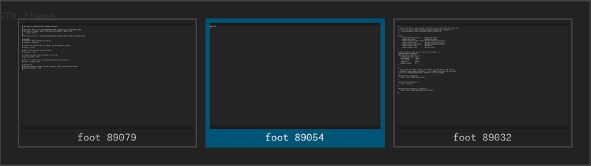

# Window switcher

Hold Alt and press Tab to move through your windows, then release Alt.
Escape cancels.

## Settings

Optional. In `~/.config/desktop-shell-components/window-switcher.ini`:

    [switcher]
    windows = all

| Setting                       | Values                                      | Default        |
|-------------------------------|---------------------------------------------|----------------|
| `windows`                     | `workspace` (current one), `all`            | `workspace`    |
| `order`                       | `recent`, `layout`                          | `recent`       |
| `previews`                    | `true`, `false`                             | `true`         |
| `preview-width`               | 64 to 640 pixels                            | `240`          |
| `label`                       | text with `{name}` `{pid}` `{title}` `{workspace}` | `{name} {pid}` |
| `follow-sway-bar` in `[appearance]` | `true`, `false` (use the GTK theme)   | `true`         |

Apply with `swaymsg reload`.

## Keys

Set in `/etc/sway/config.d/60-desktop-shell-window-switcher.conf`:

    bindsym Mod1+Tab nop desktop-shell-window-switcher next
    bindsym Mod1+Shift+Tab nop desktop-shell-window-switcher previous
