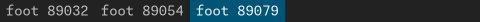

# Window bar

Lists the windows of the current workspace at the bottom of each output.
Click a window to focus it.

## Settings

Optional. In `~/.config/desktop-shell-components/workspace-window-bar.ini`:

    [bar]
    position = top

| Setting                       | Values                                      | Default        |
|-------------------------------|---------------------------------------------|----------------|
| `position`                    | `bottom`, `top`                             | `bottom`       |
| `height`                      | `auto` (same as sway's bar), 10 to 200      | `auto`         |
| `label`                       | text with `{name}` `{pid}` `{title}` `{workspace}` | `{name} {pid}` |
| `left-click`                  | `focus`, `close`, `nothing`                 | `focus`        |
| `middle-click`                | `focus`, `close`, `nothing`                 | `close`        |
| `right-click`                 | `focus`, `close`, `nothing`                 | `nothing`      |
| `follow-sway-bar` in `[appearance]` | `true`, `false` (use the GTK theme)   | `true`         |

Apply with `swaymsg reload`.

## Turn it off

Remove the package, or delete
`/etc/sway/config.d/60-desktop-shell-workspace-window-bar.conf`.
